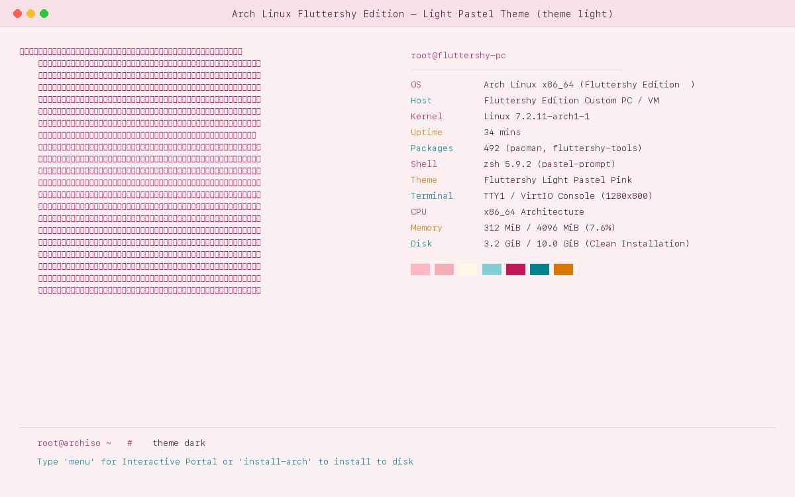
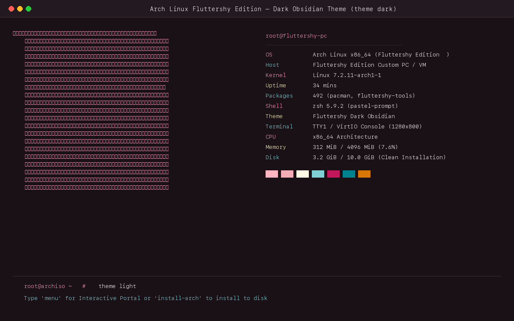

# 🌸 Arch Linux: Fluttershy Edition 🌸

[](https://archlinux.org)
[](https://github.com/mak74ik/arch-fluttershy-edition)
[](https://github.com/mak74ik/arch-fluttershy-edition/actions)
[](https://github.com/mak74ik/arch-fluttershy-edition/blob/main/LICENSE)

> *"Umm... if it's not too much trouble, welcome to my Arch Linux terminal! ...yay! ✿"*

An ultra-aesthetic, terminal-focused Arch Linux distribution inspired by **Fluttershy** from *My Little Pony: Friendship is Magic*. Features authentic Braille ASCII art, instant **Light (Pastel Blush Pink)** and **Dark (Deep Obsidian Plum)** theme switching, custom prompt indicators, fastfetch branding, and a bootable **Archiso** profile for both Live testing and 1-click guided disk installation.

---

## 📸 Скриншоты оформления / Screenshots

### 🌸 Светлая пастельная тема (Light Theme — `theme light`)
> *Нежный розовый пастельный фон, глубокий читаемый сливовый текст, бирюзовые и золотые акценты (контраст > 13:1 по WCAG).*



---

### 🌙 Тёмная обсидиановая тема (Dark Theme — `theme dark`)
> *Глубокий сливово-черный фон, мягкий пастельно-розовый и кремовый текст, аква-бирюзовые индикаторы.*



---

## 🎨 Управление темами / Instant Theme Switcher

В сборку встроен мгновенный переключатель палитры терминала:

```bash
theme light   # Включить светлую пастельную тему (чуть розовый фон, винный текст)
theme dark    # Включить тёмную обсидиановую тему (сливовый фон, нежно-розовый текст)
theme toggle  # Быстрое переключение между светлой и тёмной
```

Также тему можно переключить прямо из графического TUI-меню командой `menu` (пункт `[ 4 ]`).

---

## ✨ Ключевые возможности / Features

1. **Два режима использования из коробки**:
   - **Портативный Live Workspace**: Загружается сразу в оперативную память. Жесткий диск вообще не нужен (0 ГБ). Готов к работе за секунды!
   - **Автоматический 1-Click установщик на диск (`fluttershy-install` / `install-arch`)**: Сам размечает диск, настраивает UEFI/BIOS, ставит систему и разворачивает всю эстетику Fluttershy.
2. **Каноничный Braille ASCII Арт Fluttershy**:
   - Настоящий детальный арт из emojicombos отображается в `fastfetch` и приветственном меню.
3. **Предустановленный софт**:
   - `fastfetch`, `htop`, `kitty`, `alacritty`, `zsh`, `python3`, `git`, `curl`, `tmux`, `nano`, `vim`, `nmtui` (графический Wi-Fi).
4. **Готов к записи на флешку (Rufus / Ventoy / BalenaEtcher)** и запуску в **UTM / VirtualBox / VMware**.

---

## ⚙️ Системные требования / System Requirements

### 💻 Реальное железо (ПК / Ноутбук)
| Компонент | Минимум (Live CD) | Минимум (Установка на диск) | Рекомендуется |
|---|---|---|---|
| **Процессор** | 64-bit x86_64 (1 GHz) | 64-bit x86_64 (1 GHz) | 2.0+ GHz Multi-core |
| **ОЗУ (RAM)** | **1024 МБ (1 ГБ)** | **1536 МБ (1.5 ГБ)** | **4096 МБ (4 ГБ)** |
| **Диск (HDD/SSD)** | **0 ГБ** *(работает в RAM)* | **5 ГБ** | **10+ ГБ SSD** |
| **Флешка для записи** | USB 2.0 (>= 4 ГБ) | USB 2.0 (>= 4 ГБ) | USB 3.0+ (>= 8 ГБ) |
| **Режим загрузки** | UEFI или Legacy BIOS | UEFI или Legacy BIOS | UEFI (GPT) |

### 🖥️ Виртуальные машины (UTM / QEMU / VirtualBox / VMware)
| Параметр | Минимум (Live-запуск без установки) | Минимум (Установка в виртуалку) | Рекомендуется |
|---|---|---|---|
| **Режим на Apple Silicon (Mac M1/M2/M3/M4)** | **Emulate (x86_64)** | **Emulate (x86_64)** | **Emulate (x86_64)** |
| **Режим на Intel/AMD ПК** | **Virtualize (x86_64)** | **Virtualize (x86_64)** | **Virtualize (x86_64)** |
| **Ядра процессора (vCPU)** | 1 ядро | 1 ядро | 2–4 ядра |
| **ОЗУ виртуальной машины** | **1024 МБ (1 ГБ)** | **1536 МБ** | **2048–4096 МБ** |
| **Виртуальный диск** | **0 ГБ** *(диск не нужен, грузится с ISO)* | **5 ГБ** *(хватит под систему и TUI)* | **8–10 ГБ** |
| **Видеоадаптер** | VirtIO GPU / Standard VGA | VirtIO GPU / Standard VGA | VirtIO GPU |

> [!NOTE]
> **Хватит ли 5 ГБ хранилища?**
> - **Для Live-окружения (посмотреть, протестировать TUI и тему)**: виртуальный диск **не нужен вовсе (0 ГБ)** — вся система запускается напрямую в оперативную память из ISO.
> - **Для полноценной установки на виртуальный диск**: **5 ГБ достаточно** (установленная база с ядром, Kitty, Alacritty, Fastfetch и Python занимает около 3.1–3.4 ГБ, останется ~1.6 ГБ свободного места). Для долгосрочной работы без частой очистки кэша пакетов рекомендуется выделить 8–10 ГБ.

---

## 🚀 Как запустить на Mac в UTM

1. Открой **UTM** и нажми **«+»**.
2. **ВАЖНО**: Выбери нижний пункт — **«Эмулировать» (Emulate)** *(НЕ «Виртуализация»! На Mac с чипами M1-M4 виртуализация поддерживает только arm64, а эмуляция запускает x86_64 образ для ПК)*.
3. Выбери **Linux** $	o$ укажи скачанный ISO-файл.
4. Выдели 2048 МБ памяти и нажми **Сохранить**.
5. Нажми **▶ (Пуск)**!

---

## 📀 Запись на флешку для ПК через Rufus (Windows)

1. Вставь флешку в ПК (от 4 ГБ).
2. Скачай и запусти **Rufus**.
3. В строке «Устройство» выбери свою флешку, в строке «Метод загрузки» нажми «Выбрать» и укажи ISO-образ.
4. Схема раздела: **GPT** (для современных ПК с UEFI) или **MBR** (для старых ПК с BIOS).
5. Нажми **СТАРТ**. При запросе выбери режим **«Запись в режиме ISO-образа» (рекомендуется)** или «DD-образ».
6. Перезагрузи ПК, зайди в Boot Menu (F12, F11, F8 или Esc) и выбери флешку!

---

## 💖 Credits & Acknowledgments
- **Character Design**: Fluttershy belongs to Hasbro & *My Little Pony: Friendship is Magic* (created by Lauren Faust).
- **Arch Linux**: The Arch Linux team for the incredible distribution and `archiso` framework.
- **Crafted with love by**: Autonomous Auto Qwen AI (`mak74ik`).
